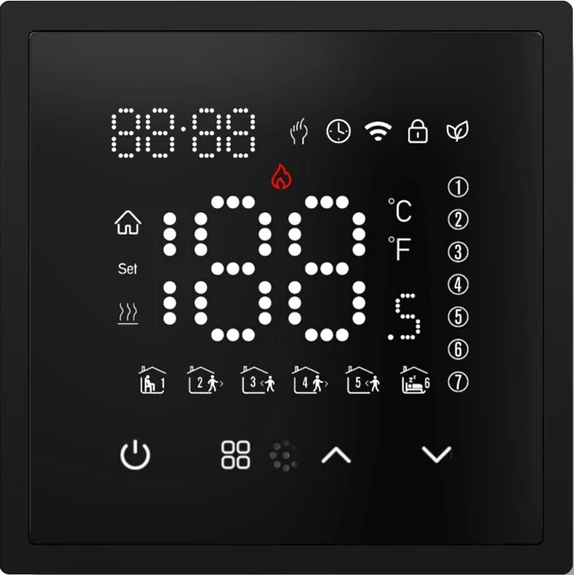
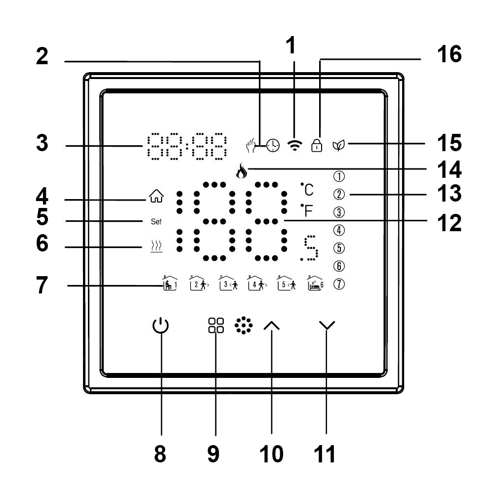
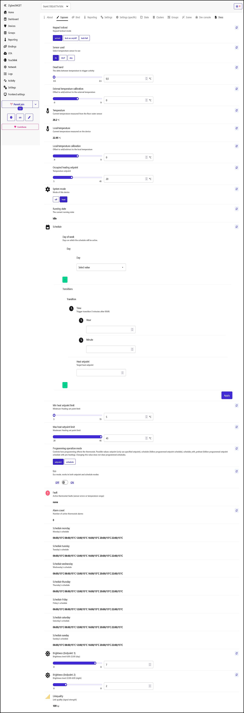

# tuya_thermostat_full_custom_r05_zrd или Open Source Thermostat (OS Thermostat)

**Автор не несет никакой ответственности, если вы, воспользовавшись этим проектом, 
превратите свой умный термостат в полоумный. А также за возможный ущерб при 
эксплуатации этого термостата.**

> [!WARNING]
> Внимание!!! В написании кода и документации для термостата активно принимал участие [**OpenCode**](https://opencode.ai/).

## [Get started](doc/getting_started.md)

## Руководство пользователя Zigbee OS Thermostat.

Термостат состоит из двух микроконтроллеров: основного **CA51F253L3**, который непосредственно управляет экраном, 
клавишами и реле нагрева, и Zigbee-модуля **ZT3L** (**Telink TLSR8258**), который общается с сетью.

Возможности:

- измерение температуры внутренним и внешним датчиками (два NTC);
- управление нагревом с гистерезисом и выбором датчика (IN / OU / AL);
- управление нагревом от внешнего беспроводного датчика температуры **Zigbee** (WS);
- недельное расписание: 7 дней × 6 переходов;
- меню настроек из 10 пунктов, калибровка датчиков, лимиты заданной температуры;
- установка часов (только 24 ч) и синхронизация времени из сети;
- блокировка клавиш, индикация состояния, дневная/ночная яркость;
- передача аварий датчиков в сеть стандартным кластером **Alarms**;
- обновление прошивок обоих MCU (**CA51F253L3** и **ZT3L**) по воздуху (через Zigbee-хаб).

---

## 1. Дисплей

### Обычный режим (термостат включён)

Номера в таблице соответствуют указателям на рисунке выше.

| № | Название | Описание |
|---|----------|----------|
| 1 | **"Сеть"** | символ Zigbee-сети (не отображается, когда термостат не подключён к сети **Zigbee**, горит постоянно, когда в сети, мигает при поиске и подключении к сети) |
| 2 | **"Режим работы"**| индикаторы режима управления: **ручной** ↔ **от расписания** |
| 3 | **"Часы"** | часы (HH:MM), двоеточие мигает раз в секунду; формат только **24 ч** |
| 4 | **"Температура комнаты"** | символ отображается, когда на экране измеренная температура одного из датчиков (гаснет, пока на экране заданная температура или настройка) |
| 5 | **"Установка"** | символ отображается, когда происходит установка температуры обогрева или выводится значение настройки, а не температура датчиков (окно живёт 7 секунд) |
| 6 | **"Внешний датчик"** | символ отображается, когда подключён и исправен **внешний (выносной) датчик**: он даёт валидные показания (нет обрыва, КЗ или таймаута). При обрыве, коротком замыкании или таймауте символ гаснет (состояние датчика проверяется раз в секунду); выход температуры за 5…45 °C символ не гасит и локально не показывается — high/low уходит только в z2m. Этот же символ используется как индикатор беспроводного датчика **WS** (см. ниже) |
| 7 | **"Слот расписания"** | слоты недельного расписания (в меню подсвечивают редактируемый слот) |
| 8 | **"Питание"** | сенсорная клавиша **Питания** |
| 9 | **"Меню"** | сенсорная клавиша **«Меню»** |
| 10 | **"Стрелка вверх"** | сенсорная клавиша **«↑»** |
| 11 | **"Стрелка вниз"** | сенсорная клавиша **«↓»** |
| 12 | **"Температура"** | температура выбранного датчика, например **23.5°С** (шаг 0.5 °C, знак «−» для отрицательных температур - есть ограничение по выводу) |
| 13 | **"День недели"** | текущий день недели (7 зелёных LED; в меню — редактируемый день) |
| 14 | **"Нагрев"** | символ отображается, когда идёт нагрев (реле включено) |
| 15 | **"Эко"** | символ режима экономии: горит, пока включён **режим ЭКО** (см. раздел 3, «Режим Эко») |
| 16 | **"Замок"** | символ отображается, когда включена блокировка клавиш |

### Специальные значения на больших цифрах

- **`E0` … `E6`** — коды неисправностей датчиков (см. раздел 6). Код
  показывается вместо температуры и относится к выбранному датчику.
- **`Er`** — нет валидного отсчёта температуры и при этом нет конкретного
  кода ошибки (резервный вариант). Обрыв и КЗ датчика показываются кодами
  `E1`…`E6`, а не `Er`.
- **`Lo` / `UP`** — значение не влезает в индикатор: `Lo` — ниже −9.99 °C,
  `UP` — выше 99.99 °C. Выход за рабочий диапазон **5…45 °C** локально не
  показывается: температура выводится числом, а в z2m уходит
  `internal/external temperature too low/high`.
- **`Set` (5)** — показывается заданная температура (а не измеренная). Окно живёт
  **7 секунд**, затем на экран возвращается измеренная температура. То же
  самое окно появляется, когда настройка пришла из сети. Исключение —
  переключение режима ручной/расписание из сети: окно не показывается,
  просто меняются иконки «рука» и «часы».
- **`UP` перед обновлением** — идёт обновление прошивки (см. раздел 8).

### Беспроводной датчик климата (WS)

Устройство принимает показания привязанного беспроводного датчика температуры
и влажности (по Zigbee-репортам, обычно не реже одного раза за 5 минут)
и использует их так:

- **пока температура приходила не позднее 5 минут назад**: большие цифры
  показывают температуру WS, и **реле управляется по ней** — независимо от
  режима IN/OU/AL в настройках;
- **если прошло больше 5 минут** (датчик разрядился/пропал из сети) или
  температура ещё ни разу не приходила: термостат мгновенно возвращается к
  датчику из настроек (IN/OU/AL, показания и коды ошибок — как обычно), а
  значения WS считаются недействительными;
- **аварийная отсечка по перегреву** (максимальный предел + запас) работает
  только по **проводным** датчикам — беспроводной в ней не участвует;
- **влажность** WS в управлении не участвует; посмотреть её можно **быстрым
  кликом по «питанию» (8)** (термостат включён): на больших цифрах на
  **3 секунды** появляется значение влажности, затем экран возвращается к
  температуре. Отдельной иконки `%RH` на r05 нет, поэтому число показывается
  без неё. Значение — **целые проценты** (округляется, 100 % показывается
  как 99). Если WS не свежий — вместо числа `--`. В выключенном состоянии
  клик ничего не делает.
- **индикатор WS** — символ **«Внешний датчик» (6)**: при первом свежем
  отчёте он мигает ~3 секунды, затем горит ровно с коротким погасанием ~1 с
  раз в 5 секунд. Когда WS протух, символ возвращается к состоянию
  проводного внешнего датчика.

### При подаче питания

1. ~3 секунды — включены все сегменты дисплея, все 7 зелёных индикаторов
   дней недели и красное пламя (самопроверка);
2. ~2 секунды — гаснет всё, кроме номера версии прошивки на больших цифрах
   (например, версия 1.01 отображается как «101»);
3. дисплей гаснет; дальше термостат продолжает работать в **последнем сохранённом
   состоянии**: если до этого был включён — сразу показывает рабочий экран,
   если выключен — экран остаётся погашенным (при включённой блокировке горит
   только **замок** (16)). Часы (3) при этом показывают 00:00 до синхронизации
   с сетью (в режиме, когда термостат включён).

---

## 2. Управление

Клавиши сенсорные: **Питание (8)**, **«Меню» (9)**, **«↑» (10)**,
**«↓» (11)**. На r05 клавиш четыре — отдельной клавиши «Часы» нет.

| Жест | Как делать |
|---|---|
| Короткое нажатие | нажать и быстро отпустить (до 0.5 с) |
| Удержание | держать; действие срабатывает через указанные в таблице время |
| Автоповтор | при удержании стрелок повтор каждые ~60 мс |

### Термостат выключен

| Клавиша | Жест | Действие |
|---|---|---|
| Питание | удержание **1.2 с** | включить (короткий клик ничего не делает) |
| «Меню» | удержание **3.0 с** | войти в меню настроек (экран загорается) |
| «↓» | удержание **2.0 с** | подключение к сети: знак «сеть» начинает мигать, устройство инициирует подключение к Zigbee-сети (если «↓» нажат один) |
| «↑» + «↓» | удержание **2.0 с** | переключить режим блокировки клавиш |
| Остальные | — | не действуют |

### Термостат включён

| Клавиша | Жест | Действие |
|---|---|---|
| Питание | удержание **1.2 с** | выключить |
| Питание | короткое нажатие | показать влажность WS на 3 секунды (см. раздел 1) |
| «Меню» | короткое нажатие | переключить режим: **Ручной ↔ Расписания** |
| «Меню» | удержание **3.0 с** | войти в установку часов (после неё открывается редактор расписания) |
| «↑» / «↓» | клик или удержание | изменить заданную температуру шагом 0.5 °C (**только в ручном режиме**); на экране загорается `Set`, значение отображается 7 с |
| Питание + «Меню» | удержание **2.0 с** | включить или выключить **режим ЭКО** (иконка «Эко», 15) |
| «↑» + «↓» | удержание **2.0 с** | переключить режим блокировки клавиш |

> В режиме «Расписания» стрелки заданную температуру не меняют — её
> задаёт расписание.

---

## 3. Режимы и настройка

### Включение и выключение

При подаче питания устройство стартует в **последнем сохранённом состоянии** —
термостат запоминает, был ли он включён или выключен (после заводского сброса —
выключен). Переключение — только удержанием клавиши питания 1.2 сек.

Выключенный термостат продолжает измерять температуру и сообщать её в сеть —
просто он не включает нагрев и экран погашен. Нагрев всегда выключен, когда термостат
выключен или идёт обновление прошивки.

### Ручной режим и расписание

- **Ручной режим** (иконка «рука», 2): заданную температуру меняют стрелками или
  из сети.
- **Режим от расписания** (иконка «часы», 2): действует недельное расписание,
  заданная температура автоматически меняется по его переходам. Между
  переходами (в том числе ночью, до первого перехода дня) держится
  температура предыдущего перехода; если расписание пустое — используется
  заданная температура. Стрелки в этом режиме её не меняют. На главном экране
  горит иконка того слота (7), переход которого действует сейчас (до первого
  перехода дня — иконка вчерашнего последнего слота).
- Переключение — короткое нажатие «Меню». Переключение не очищает расписание.
  Режим можно переключить и из сети — иконки «рука»/«часы» меняются сразу,
  без окна настройки.

### Режим Эко

Режим экономии энергии (Economy/EnergyStar), **независимый** от выбора
«Ручной ↔ Расписание»: его можно включить в любом из этих режимов.

- **Что делает:** пока режим ЭКО включён, нагрев управляется от заданной
  температуры **минус 3 °C**. Пример: заданная 20.0 °C, гистерезис 1.0 °C,
  ЭКО включён → нагрев включается ниже 16.0 °C и выключается выше 18.0 °C
  (точки сдвинуты вниз на 3 °C).
- **Сами заданные температуры не меняются**: стрелки и окно установки
  показывают исходное значение, слоты расписания хранят свои температуры —
  сдвигается только фактическая точка включения. Меняете заданную температуру
  стрелками — ЭКО по-прежнему вычитает 3 °C из нового значения.
- **Лимиты действуют как обычно** (пункты меню 06/07): если «заданная − 3 °C»
  оказывается ниже минимальной температуры, нагрев идёт до минимума.
- Режим применяется к той температуре, которая действует сейчас: в ручном
  режиме — к заданной, в расписании — к температуре текущего слота.
- **Индикация:** символ **«Эко»** (15) горит на дисплее, пока режим включён
  (при выключенном термостате экран погашен).

**Как включить/выключить:**

- с устройства — аккорд **«Питание» + «Меню», удержание 2.0 с** (при включённом
  термостате; в выключенном жест ничего не делает); при включённой блокировке
  клавиш жест не работает, как и другие клавиши;
- из сети — переключением режима экономии в Zigbee-приложении (это
  отдельный бит того же атрибута режима программы, что и «Ручной ↔
  Расписание»): иконка обновляется сразу, без окна настройки.

Состояние сохраняется при обесточивании и восстанавливается при включении.

### Установка часов

1. При включённом термостате удержать **«Меню» 3.0 с**.
2. По очереди мигают и настраиваются: **день недели (13) → часы (3) → минуты**.
   Стрелки листают значения с упором (день 1…7, часы 0…23, минуты 0…59).
3. Короткое нажатие «Меню» — переход к следующему шагу; на последнем шаге
   время применяется и открывается редактор расписания.
4. Выход — клавиша питания или **удержание «Меню»** (время сохраняется),
   либо **20 секунд без нажатий** — автовыход с сохранением.
5. Если во время установки часов из сети придёт расписание, настройка
   закроется сразу, а набранное время **не** применится: сохраняется только
   то, что пришло из сети.

Формат времени на r05 — только **24 часа**; переключения 24 ч ↔ AM/PM нет.

Часы могут синхронизироваться из сети после подключения; без синхронизации они
идут с 00:00.

### Недельное расписание (7 дней × 6 слотов)

1. Вход — через установку часов: после последнего шага (минуты) редактор
   расписания открывается сам. Отображается **хаб выбора дня**: горит только
   мигающая иконка дня недели (13). Стрелки выбирают день (Пн…Вс), короткое
   «Меню» — вход в этот день.
2. Внутри дня настраиваются **6 слотов (SP1…SP6)**: время и температура.
   Короткое нажатие «Меню» ведёт по полям: **часы → минуты → температура →
   следующий слот → следующий день**. Редактируемое поле мигает; слот (7) и
   день (13) видны по иконкам.
3. После 6-го слота день сохраняется и возврат в хаб со **следующим днём**
   (дни можно перепрыгивать стрелками). После воскресенья редактор закрывается.
4. Выход — клавиша питания или **удержание «Меню»**: текущий слот и день
   сохраняются. **Нетронутые слоты остаются пустыми** — можно заполнить меньше
   шести слотов в день. Либо **20 секунд без нажатий** — автовыход с
   сохранением (в хабе выбора дня — просто выход).
5. Незаданный слот (не заполнены и часы, и минуты) показывается как `--:--`;
   перехода в нём нет.
6. Когда день завершён (короткое «Меню» после 6-го слота), при выходе из
   редактора или после записи из сети переходы **упорядочиваются по времени**
   (пустые слоты — в конце): так они хранятся и так их показывает приложение.
7. Если во время настройки расписания из сети придёт расписание (реально
   изменяющее день), настройка закроется; сохраняется только пришедшее из
   сети, несохранённая локальная правка этого дня отбрасывается.

### Меню настроек

Вход: удержание **«Меню» 3.0 с** при **выключенном** термостате — экран
загорается. Пока меню открыто, экран остаётся включённым на максимальной
яркости; после выхода или 20 секунд без нажатий гаснет. При включённом
термостате это же удержание открывает установку часов, поэтому в меню можно
попасть только из выключенного состояния. Номер пункта (01…10) выводится на
малых цифрах (3), значение — на больших (12).

| № | Пункт | Диапазон, шаг | Назначение |
|---|---|---|---|
| 01 | Калибровка внутреннего датчика | −9.0 … +9.0, 0.5 | поправка показаний внутреннего датчика |
| 02 | Калибровка внешнего датчика | −9.0 … +9.0, 0.5 | поправка показаний внешнего датчика |
| 03 | Гистерезис | 0.5 … 2.5, 0.5 | ширина полосы включения/выключения нагрева |
| 04 | Режим блокировки кнопок | 1 … 2 | какой режим включает аккорд «↑»+«↓»: 1 — всё, кроме питания; 2 — всё запрещено |
| 05 | Датчик | IN / OU / AL | какой датчик показывает температуру и управляет нагревом |
| 06 | Минимальная заданная температура | 5.0 … 15.0, 0.5 | нижняя граница заданной температуры |
| 07 | Максимальная заданная температура | 20.0 … 45.0, 0.5 | верхняя граница заданной температуры |
| 08 | Яркость день (06:00–22:00) | 0 … 8 | уровень яркости днём (0 — всё погашено) |
| 09 | Яркость ночь (22:00–06:00) | 0 … 8 | уровень яркости ночью |
| 10 | Сброс к заводским | 0 / 1 | при значении 1 — полный сброс настроек и расписания; после сброса пункт снова 0 |

Навигация в меню: короткое **«Меню»** — следующий пункт (предыдущий
сохраняется), **стрелки** — правка значения, **клавиша питания** — сохранить и
выйти (термостат НЕ выключается), **20 секунд без нажатий** — автовыход с
сохранением. Удержание «Меню» в меню настроек ничего не делает.

Лимиты пунктов 06/07 задаются независимо друг от друга и не зависят от текущей
заданной температуры: минимальная строго 5…15, максимальная строго 20…45.

### Блокировка клавиш

- Включение/выключение — аккорд **«↑» + «↓», удержание 2.0 с**, в любом
  порядке нажатия и в любом состоянии питания. Это единственный способ
  разблокировать клавиши с самого устройства.
- В выключенном состоянии одиночное удержание **«↓» 2.0 с** по-прежнему
  запускает подключение к сети: если нажаты обе стрелки — срабатывает
  блокировка, сеть стартует только от «↓», нажатого одного.
- Режим при включении берётся из **меню, пункт 04**:
  - **1 — «всё, кроме питания»**: работает только клавиша питания;
  - **2 — «всё запрещено»**: не работает ничего, кроме аккорда.
- Если режим **2** включён, пока открыты меню настроек, настройка часов или
  расписание — этот режим **сразу закрывается** (с сохранением, как при
  выходе клавишей питания), потому что управлять им больше нечем.
- Индикация: при включённом термостате замок (16) горит постоянно; при выключенном
  (тёмный экран) после смены блокировки замок кратко мигает ~5 раз (~3 с).
  При включённой блокировке в **выключенном** состоянии **замок горит постоянно**
  на яркости из настроек (день/ночь); при снятии блокировки он гаснет, при
  яркости 0 гаснет всё.
- Блокировку можно менять и из сети — индикация та же.

---

## 4. Как греет термостат

- **Гистерезис симметричный, ± вокруг заданной температуры**: нагрев
  включается, когда температура опустилась до «заданная − гистерезис», и
  выключается, когда поднялась до «заданная + гистерезис». Пример: заданная
  температура 20.0, гистерезис 1.0 → включается ниже 19.0, выключается выше
  21.0.
- **Минимальное время выключенного состояния — 30 секунд.** После любого
  выключения реле следующее включение возможно не раньше, чем через 30 с
  (защита от слишком частых пусков). Как только это время истекло, включение
  происходит сразу при выполнении условия. Выключение всегда происходит
  сразу же. Сразу после включения питания первая задержка не действует.
- **Датчик (пункт меню 05):**
  - **IN** — только внутренний датчик; при его отказе нагрев выключается;
  - **OU** — только внешний; если внешний датчик отсутствует или оборван,
    нагрев не включается вообще (переключения на внутренний нет);
  - **AL** — работают оба датчика: включение только когда **оба** холодны,
    выключение — когда **хотя бы один** тёплый. Если отказал внешний, нагрев
    ведётся по внутреннему, а экран чередует его температуру (5 секунд) и код
    ошибки внешнего (1,5 секунды). Если отказал внутренний, нагрев ведётся по
    внешнему, а код внутреннего уходит в сеть, не на экран. Если отказали оба —
    нагрев выключен, на экране `Er`.
- **Беспроводной датчик климата (WS)**, если его температура приходила не
  позднее 5 минут назад, управляет нагревом **вместо датчика из настроек** —
  независимо от режима IN/OU/AL; при этом гистерезис, 30-секундная задержка
  и лимиты действуют как обычно. Как только показания WS протухают (или не
  приходили ни разу), нагрев без задержки возвращается к датчику из настроек.
  Аварийная отсечка по перегреву следит только за проводными датчиками.
- **Лимиты заданной температуры** (пункты 06/07) ограничивают диапазон, в
  котором стрелки и редактор расписания могут менять заданную температуру.
  Записанное в расписание значение хранится как есть (в пределах допустимого),
  но **при работе** термостат использует его внутри лимитов: если слот ниже
  min — греет до min, если выше max — до max. То же касается и заданной
  температуры в ручном режиме: если значение вне лимитов (например, пришло
  из сети до того, как лимиты изменили), нагрев всё равно удерживается внутри
  лимитов. Изменение лимитов сразу меняет поведение, не переписывая
  расписание (слот возвращается к исходному значению, когда лимиты
  возвращаются).
- **Режим ЭКО** (раздел 3, «Режим Эко»): пока он включён, точка
  включения/выключения нагрева смещена вниз на **3 °C** относительно заданной
  температуры (в расписании — относительно температуры текущего слота).
  Заданные температуры и расписание при этом не переписываются, гистерезис,
  30-секундная задержка и лимиты действуют как обычно.
- Пока термостат выключен или обновляется, нагрев принудительно выключен.

---

## 5. Яркость

- Уровни 0…8 (0 — дисплей полностью погашен), отдельно для дня
  (06:00–22:00) и ночи (22:00–06:00) — пункты меню 08 и 09.
- От уровня зависят и прямые LED: красное пламя (P5.4/PWM4) и общий зелёных
  дней (P5.5/PWM5) идут по той же кривой, что и матрица; на 0 они тоже гаснут.
- При включённом термостате любое нажатие клавиши поднимает яркость на
  максимум на 20 секунд, затем возвращается к дневному/ночному уровню.
- При выключенном: экран сразу гаснет — отдельных подсветок клавиш или
  «листочка» на r05 нет. Если включена блокировка, замок (16) показывается
  на максимуме яркости ~7 секунд, затем переходит на дневной/ночной уровень;
  без блокировки экран остаётся полностью погашенным. Подключение к сети
  (мигание «сеть») тоже временно зажигает дисплей на максимуме.

---

## 6. Измеренная и заданная температура на экране

- В обычном режиме большие цифры (12) показывают измеренную температуру; домик (4)
  подтверждает, что это именно измерение.
- Нажатие стрелки (ручной режим) или приход настройки из сети показывает
  заданную температуру (значение) с иконкой `Set` (5) на 7 секунд, затем
  возвращается измеренная температура.
- Рабочий диапазон — **5…45 °C**; порог фиксированный и не зависит от лимитов
  заданной температуры (пункты меню 06/07). Выход за него больше не заменяет
  число: температура показывается как есть, а в z2m уходит
  `internal/external temperature too low/high`.

### Ошибки датчиков

| Код | Значение |
|---|---|
| `E0` | неизвестная/системная ошибка (зарезервировано, сейчас не выставляется) |
| `E1` | внутренний датчик: обрыв |
| `E2` | внутренний датчик: короткое замыкание |
| `E3` | внешний датчик: обрыв |
| `E4` | внешний датчик: короткое замыкание |
| `E5` | внутренний датчик: таймаут АЦП |
| `E6` | внешний датчик: таймаут АЦП |

- Код показывается вместо температуры: в режиме **IN** — только
  `E1`/`E2`/`E5`, в **OU** — только `E3`/`E4`/`E6`. В **AL** код внешнего
  показывается при его отказе, код внутреннего уходит только в сеть. Ошибка
  «чужого» датчика в IN/OU на экран не выводится.
- `E0` — общий: если выбранный датчик исправен, `E0` мигает попеременно с
  температурой.
- В **AL**:
  - отказал **внешний** — 5 секунд температура внутреннего, 1,5 секунды
    код ошибки внешнего (E3/E4/E6); цикл повторяется;
  - отказал **внутренний** — показывается температура внешнего, код
    внутреннего (E1/E2/E5) только в сеть;
  - отказали **оба** — на экране `Er`.
  В **IN/OU** при отказе выбранного датчика код горит постоянно.
- `E7`…`E9` — резерв, не выводятся.
- `Er` — нет валидного отсчёта температуры и нет конкретного кода ошибки
  (резервный вариант). Обрыв/КЗ показываются кодами `E1`…`E6`.
- **Settling 20 секунд.** Неисправность (обрыв, КЗ, таймаут) фиксируется
  сразу — код ошибки появляется на экране. После восстановления исправного
  контакта термостат ещё 20 секунд подряд ждёт стабильный валидный отсчёт, не
  обновляя температуру и состояние реле: это гасит ложные срабатывания
  high/low при заряде входного конденсатора.
  Поэтому после устранения неисправности код может оставаться на экране до
  20 секунд. Переход `E4 → E3` идёт с паузой (вход проходит через валидный
  диапазон), `E3 → E4` — сразу.
- Если свежий WS управляет нагревом, ошибки проводных датчиков на экран не
  выводятся — цифрами владеет WS.

---

## 7. Сеть (Zigbee)

- Иконка «сеть» (1) горит постоянно, когда устройство подключено к сети.
- **Подключение к сети:** при выключенном термостате удержать **«↓» 2.0 с** —
  знак «сеть» начинает мигать (~1.5 минуты), устройство инициирует
  подключение к Zigbee-сети. Мигание прекращается автоматически по истечении
  времени или раньше, когда подключение подтверждено.
- Настройки, изменённые на устройстве, передаются в сеть; настройки из сети
  применяются к термостату (и показываются окном `Set`, если термостат
  включён; переключение режима ручной/расписание окно не показывает — сразу
  меняются иконки).

---

## 8. Обновление прошивки

Обновление запускается из Zigbee-хаба и занимает некоторое время:

Файлов обновлений два. Один для **Zigbee** модуля **ZT3L** и второй для **CA51F253L3**.
Оба обновления заливаются через **Zigbee**, в данном случае через **zigbee2mqtt**.
Отличить образ можно по вхождению в имя **ZT3L** или **CA51F253L3**.

При обновлении **ZT3L** на экране ничего не отображается.

Обновление **CA51F253L3** происходит в два этапа. Сначала обновление грузится в **ZT3L**.
После полной загрузки файла обновления, **ZT3L** загружает этот файл в **CA51F253L3**.
Пока файл грузится в **ZT3L** тоже ничего не отображается. Когда процесс заливки файла
закончится и **ZT3L** начнёт передачу файла в **CA51F253L3**, то

1. на больших цифрах появляется **`UP`** (дисплей на максимуме яркости),
   нагрев на это время выключен;
2. при успехе кратко показывается **`AL`** (порядка 2 секунд), затем устройство
   перезагружается с новой версией;
3. при сбое передачи показывается **`Er`** — обновление нужно запустить заново.

Если версии совпадают, обновление не запускается.

---

## 9. Как это выглядит в zigbee2mqtt

Кроме стандартных сущностей термостата (температура, заданная температура,
режим, состояние нагрева, блокировка, яркость и расписание), устройство
отдаёт две сущности, связанные с авариями:

- **`fault`** (`text`) — человекочитаемый список активных ошибок:
  `unknown fault`, `internal sensor open`, `internal sensor short`,
  `external sensor open`, `external sensor short`,
  `internal sensor timeout`, `external sensor timeout`,
  `internal temperature too high`, `internal temperature too low`,
  `external temperature too high`, `external temperature too low`;
  при отсутствии ошибок — `none`;
- **`alarm_count`** (`numeric`) — число активных аварий.

Аварии передаются стандартным кластером **Alarms (0x0009)**: отдельными
`Alarm`-командами с `clusterId = 0x0201` (Thermostat). Коды vendor-specific,
чтобы не пересекаться со стандартными кодами Thermostat `0x00`…`0x02`:
`E0`…`E6` — `0x80`…`0x86`, выход температуры за пределы — `0x90`…`0x93`
(`0x90` — внутренний high, `0x91` — внутренний low, `0x92` — внешний high,
`0x93` — внешний low). Кастомных ZCL-атрибутов для ошибок нет. После
изменения набора аварий устройство отправляет снапшот (все активные `Alarm`,
затем `AlarmCount`), повторяет его через 15 секунд, а далее раз в 60 секунд,
пока ошибки активны; когда ошибок не осталось — отправляет финальный `0`.

## 10. Назначение OTA файлов.

| Имя файла | Назначение |
|-----------|------------|
| 1141-d3a3-1111114b-osrctherm_r05_zrd_ZT3L.zigbee | Обновление ZT3L из оригинального в кастомный |
| 6565-0391-65653001-old_tuya_thermostat_r05_ZT3L.zigbee | Обновление ZT3L, если его уже перешили в термостат из [предыдущего проекта](https://github.com/slacky1965/tuya_thermostat_zrd) |
| 6565-03b5-10013001-osrctherm_r05_zrd_ZT3L.zigbee | Обновление ZT3L уже перешитого термостата из этого проекта |
| 6565-03b5-65653001-osrctherm_r05_v1.01_CA51F253L3.zigbee | Обновление CA51F253L3 уже перешитого термостата из этого проекта |

Версия в именах файлов (`10013001`, `v1.01`) меняется при выпуске новой
прошивки; ориентироваться нужно на префиксы `osrctherm_r05_zrd_ZT3L` и
`osrctherm_r05_v…_CA51F253L3`.

## 11. [Протокол обмена между ZT3L и CA51F253L3](doc/serial.md)

