# Термостат: железо и прошивка

### Данный проект подходит к термостатам.

- С оригинальной прошивкой они определяются в **zigbee2mqtt** так
	- "_TZE204_5toc8efa"
- Внешний вид
	- 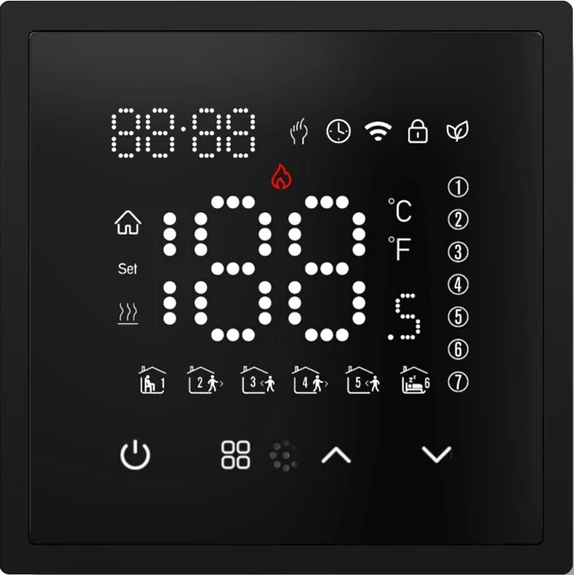
- Плата
	- Смотри в разделе [Железо](#1-железо)
	
> [!WARNING]
> Внимание!!! Если слаботочная плата хоть немного отличается от той, что на фото, обновлять ничего не нужно. Есть большая вероятность получить кирпич.
	
## Содержание

- [1. Железо](#1-железо)
- [2. Сборка проекта](#2-сборка-проекта)
- [3. Как обновить](#3-как-обновить)
  - [Этап 1. OTA-обновление ZT3L](#этап-1-ota-обновление-zt3l)
  - [Этап 2. Прошивка CA51F253L3](#этап-2-прошивка-ca51f253l3)

---

## 1. Железо

### Слаботочная плата термостата с экраном

<div align="center">
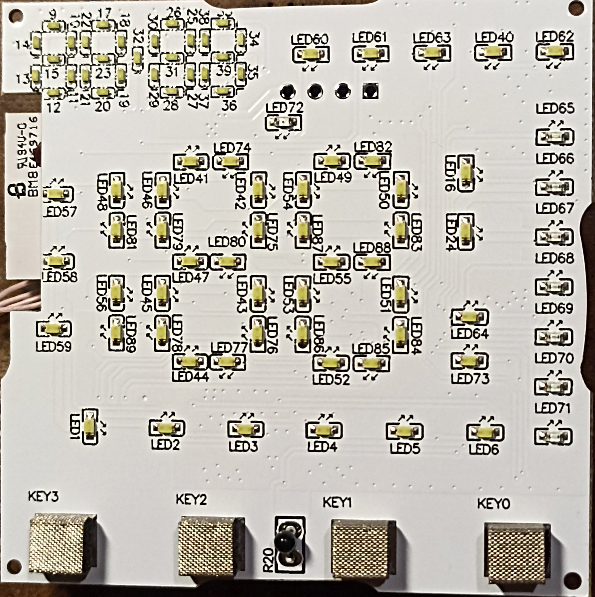 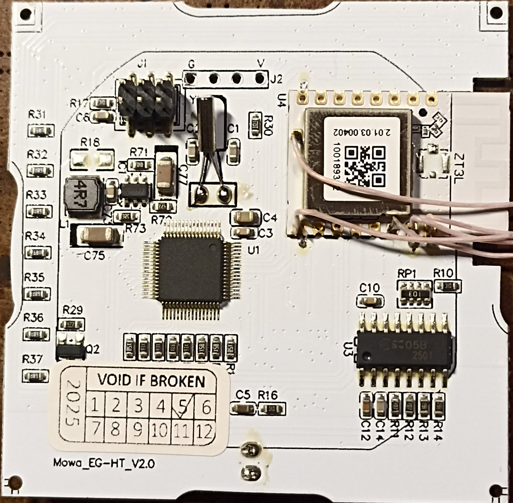
<p align="center"><em>Слаботочная плата: вид сверху и вид снизу</em></p>
</div>

---

## 2. Сборка проекта

### Инструменты

Для сборки проекта под Windows нужно скачать несколько инструментов.

| Инструмент | Обязательность |
| --- | --- |
| [clang](https://github.com/devbis/llvm-mcs51/releases) | обязательно |
| [Telink IoT Studio](https://doc.telink-semi.cn/tools/telink_iot_studio/TelinkIoTStudio_V2025.2.zip) | обязательно |
| [Git for Windows](https://git-scm.com/install/windows?ref=faun) | рекомендуется |

В системе должен быть инсталлирован **python**.

Если нужно только прошить **CA51F253L3**, то **Telink IoT Studio** можно не скачивать.

### Сборка (если нужно, а так, собранные файл уже лежат в **./bin**)

После установки всех компонентов запускаем **Git Bash** и переходим в папку проекта. Далее выполняем

```text
$ make bootloader clean all DEBUG=OFF
```

Проверяем вывод компилятора. Должно собраться три основных файла - **bootloader** для **TLSR8258**, и две **firmware** для **TLSR8258** и **CA51F253L3**. Попутно еще создаются образы **ОТА**. Все будет лежать в директории **bin**.

---

## 3. Как обновить

Сразу скажу, обновить **CA51F253L3** по ОТА из оригинальной прошивки в кастомную нельзя. В протоколе Tuya есть такой механизм, но проектировщики этого термостата не реализовали такую возможность. Но с другой стороны, для перепрошивки **CA51F253L3** не нужен какой-то отдельный программатор. Достаточно обычного **USB-UART** адаптера.

Итак. Обновление будет происходить в два этапа. Сначала по **ОТА** обновляем zigbee-модуль ZT3L. А затем мы уже прошьем проводами **CA51F253L3**.

### Этап 1. OTA-обновление ZT3L

#### Шаг 1. Добавление оригинального термостата в zigbee2mqtt

У вас должно получиться что-то типа вот такого

<div align="center">
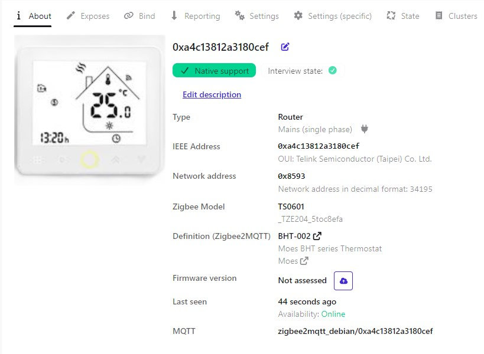
<p align="center"><em>Оригинальный термостат в zigbee2mqtt</em></p>
</div>

#### Шаг 2. Загрузка OTA-образа и запуск обновления

Далее жмем на синее облачко и выбираем **custom firmware** и добавляем **ОТА** образ для обновления - [1141-d3a3-1111114b-osrctherm_r05_zrd_ZT3L.zigbee](https://github.com/slacky1965/tuya_thermostat_full_custom_r05_zrd/raw/refs/heads/main/bin/1141-d3a3-1111114b-osrctherm_r05_zrd_ZT3L.zigbee) и жмем обновить.

<div align="center">
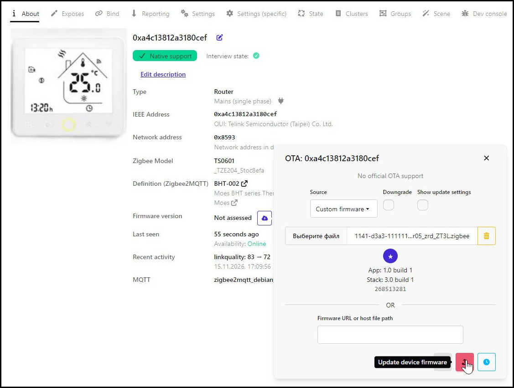
<p align="center"><em>Добавление OTA-образа в zigbee2mqtt</em></p>
</div>

#### Шаг 3. Проверка лога и результата

Далее в логе можно наблюдать отчеты об обновлении.

<div align="center">
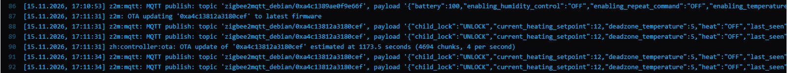
<p align="center"><em>Лог: обновление началось</em></p>
</div>

В процессе обновления в логе также можно увидеть информацию о кол-ве оставшихся секунд и процент загрузки.

<div align="center">
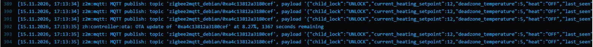
<p align="center"><em>Лог: оставшееся время и процент загрузки</em></p>
</div>

Также в логе можно наблюдать окончание обновления.

<div align="center">
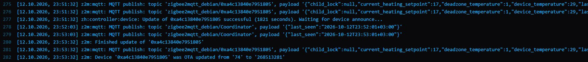
<p align="center"><em>Лог: обновление завершено</em></p>
</div>

После успешного обновления нужно разрешить добавление новых устройств в zigbee2mqtt и термостат сам подключится к сети уже с новым именем и адресом. Старую версию термостата принудительно удаляем. У вас должно получиться что-то в этом роде.

<div align="center">
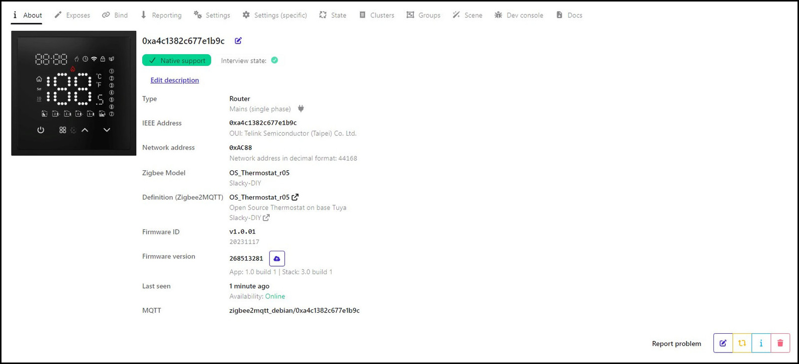
<p align="center"><em>Термостат после обновления в zigbee2mqtt</em></p>
</div>

### Этап 2. Прошивка CA51F253L3

Для этого нужно обесточить термостат.

> [!WARNING]
> Внимание!!! При отсоединенной слаботочной плате нельзя подавать питание на силовую часть термостата!!!

Нужно понянуть экран на себя, он держится на силовой части только на разъеме (возможно у него есть еще рамка, но это было давно, я ничего от него не нашел). С задней части экрана аккуратно шлитцевой отверткой снимаем крышку и вынимаем всю плату. На ней нужно найти место с нераспаянным разъемом **J2**. Паять ничего не нужно, вполне подойдут провода **Dupont**, которые просто "втыкаются" в отвертия нераспаянного разъема **J2**. Далее подключаем к **USB-UART** адаптеру согласно надписям на фото ниже - контакт **RX** на плате нужно подключать к **RX** адаптера, контакт **TX** на плате - к **TX** адаптера. Также подключаем **VCC** -> **+3.3** вольта, а вот **GND** пока не подключаем.

<div align="center">
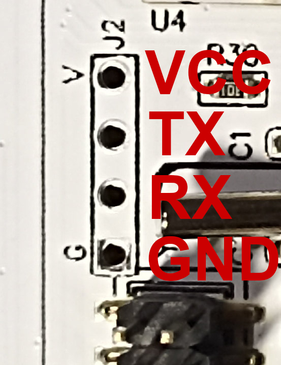
<p align="center"><em>Подключение <b>USB-UART</b> к разъему <b>J1</b></em></p>
</div>

Предварительно проверяем, на каком порту сидит **USB-UART** адаптер и редактируем в корне проекта в **makefile** параметр **CA51F2_PORT** на тот, который у вас.

<div align="center">
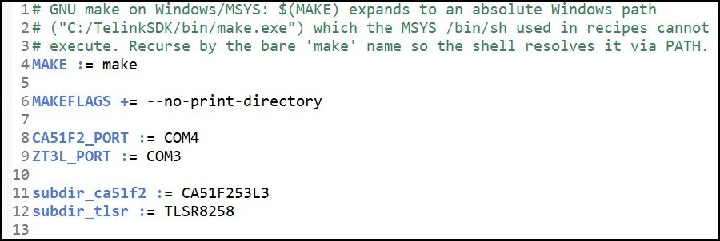
<p align="center"><em>Параметр <b>CA51F2_PORT</b> в <b>makefile</b></em></p>
</div>

Далее заходим в **Git Bash**, переходим в директорию проекта. И даем команду для сохранения оригинального дампа всей флеш.

```text
$ make flash-orig-read-cachip
```

> [!NOTE]
> Запускается небольшая программа на **python**'е, которая и прошивает **CA51F253L3**. Программа немного модифицирована под себя. Оригинал - [https://github.com/MrdUkk/cachip-ispuartflasher](https://github.com/MrdUkk/cachip-ispuartflasher)

У нас есть 15 секунд, чтобы соединить **GND** от **USB-UART** адаптера с экраном термостата. Должны получить примерно вот такой вывод в консоле.

<details>
<summary>Пример вывода команды <b>make flash-orig-read-cachip</b></summary>

```text
$ make flash-orig-read-cachip
make -C CA51F253L3 PORT=COM4 flash-orig-read-cachip
py ./tools/cachip-isp-serial_new.py COM4 download ca51f253l3_TZE204_5toc8efa.bin
using embedded phase1 bootloader (642 bytes)
opening serial port COM4
trying ISP-mode activation, waiting up to 15 seconds (if power is already applied, pulse RESET pin 2 low->high !)
still waiting for the MCU (1s of 15s) - apply power or pulse RESET now
still waiting for the MCU (2s of 15s) - apply power or pulse RESET now
still waiting for the MCU (3s of 15s) - apply power or pulse RESET now
still waiting for the MCU (4s of 15s) - apply power or pulse RESET now
still waiting for the MCU (5s of 15s) - apply power or pulse RESET now
still waiting for the MCU (6s of 15s) - apply power or pulse RESET now
still waiting for the MCU (7s of 15s) - apply power or pulse RESET now
still waiting for the MCU (8s of 15s) - apply power or pulse RESET now
MCU accepted connection
sending some magic cmd
got mcu success response
switching port speed
sending next magic cmd
got mcu response, asserting values
valid
sending our bootloader
got mcu success response
got mcu success response
got mcu success response
got mcu success response
got mcu success response
got mcu success response
reading hidden 0x2B area to identify the chip
chip identified: CA51F253L3, flash size 32768 bytes
requesting access to flash with designated chipID
got mcu success response
requesting onchip flash memory read with size 32768 to ca51f253l3_TZE204_5toc8efa.bin
downloaded 32768/32768 bytes (100%)
download done: 32768 bytes saved to ca51f253l3_TZE204_5toc8efa.bin
sending session end cmd
got mcu success response
end, remove power from MCU
```

</details>

Оригинальный дамп сохранится в каталоге **`CA51F253L3`**

После того, как сохранили дамп флеш, отсоединяем опять **GND**. Делее даем такую команду.

```text
$ make flash-cachip
```

И снова соединяем **GND**. Должны получить следующее в консоле.

<details>
<summary>Пример вывода команды <b>make flash-cachip</b></summary>

```text
$ make flash-cachip
make -C CA51F253L3 PORT=COM4 flash-cachip
py ./tools/cachip-isp-serial_new.py COM4 upload ../bin/osrctherm_r05_v1.01_CA51F253L3.bin
using embedded phase1 bootloader (642 bytes)
opening serial port COM4
trying ISP-mode activation, waiting up to 15 seconds (if power is already applied, pulse RESET pin 2 low->high !)
still waiting for the MCU (1s of 15s) - apply power or pulse RESET now
still waiting for the MCU (2s of 15s) - apply power or pulse RESET now
still waiting for the MCU (3s of 15s) - apply power or pulse RESET now
MCU accepted connection
sending some magic cmd
got mcu success response
switching port speed
sending next magic cmd
got mcu response, asserting values
valid
sending our bootloader
got mcu success response
got mcu success response
got mcu success response
got mcu success response
got mcu success response
got mcu success response
reading hidden 0x2B area to identify the chip
chip identified: CA51F253L3, flash size 32768 bytes
requesting verify chipID for next phases
got mcu success response
requesting access to flash with designated chipID
got mcu success response
requesting onchip flash memory partial 229 sectors erase
got mcu success response
uploading from ../bin/osrctherm_r05_v1.01_CA51F253L3.bin to onchip memory
written 29310/29310 bytes (100%)
upload done: 29310 bytes written to onchip flash
sending session end cmd
got mcu success response
end, remove power from MCU
```

</details>

Все. На этом можно термостат собирать обратно.
